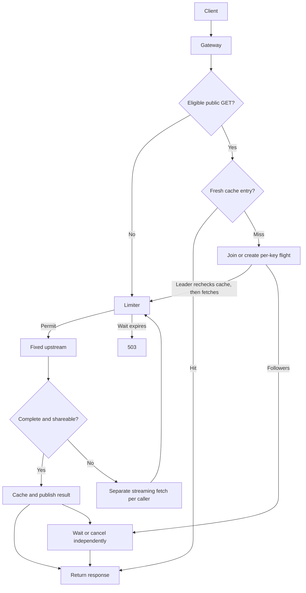

# High-Performance API Gateway

A learning project exploring a single-upstream reverse proxy, bounded caching,
request coalescing, and overload protection. See the project plan for the full scope.

## Current status: Milestone 5

The gateway forwards ordinary HTTP requests to one fixed upstream using a shared
connection pool, bounded LRU/TTL cache, request coalescing, and downstream concurrency
limiting. Reproducible local measurements and profiling evidence are recorded in
[docs/results.md](docs/results.md), with raw trials under `bench/results`.

Requires Go 1.25 or later. Commands below work in PowerShell and Linux/WSL2.

## Five-minute setup

From the repository root, build the two programs:

```powershell
go build -o bin/mockbackend.exe ./cmd/mockbackend
go build -o bin/gateway.exe ./cmd/gateway
```

In terminal 1, start `./bin/mockbackend.exe -delay 50ms`. In terminal 2:

```powershell
$env:CACHE_ENABLED = 'true'
./bin/gateway.exe -upstream http://127.0.0.1:9000
```

In terminal 3, send two identical requests within 10 seconds:

```powershell
curl.exe --fail 'http://127.0.0.1:8080/api/public/item?id=42'
curl.exe --fail 'http://127.0.0.1:8080/api/public/item?id=42'
curl.exe --fail 'http://127.0.0.1:9000/stats'
```

Both item responses should be `{"id":"42","name":"demo item"}` and a fresh
backend should report a `calls` value of `1` (along with activity statistics). Stop both programs with Ctrl+C.

Linux/WSL2 equivalent (Go must be installed in that environment):

```sh
go build -o bin/mockbackend ./cmd/mockbackend
go build -o bin/gateway ./cmd/gateway
./bin/mockbackend -delay 50ms
# Another terminal:
CACHE_ENABLED=true ./bin/gateway -upstream http://127.0.0.1:9000
# A third terminal: use curl instead of curl.exe for the same requests above.
```

## Request flow



The diagram shows coalescing enabled. Bypass requests stream their original
upstream response. Shared speculative fetches use the fallback only when the
response cannot be shared. See [design tradeoffs](docs/design.md) for ownership,
failure paths, memory bounds, and interview discussion points.

## Run locally

In one terminal:

```sh
go run ./cmd/mockbackend -addr 127.0.0.1:9000 -delay 50ms
```

In another terminal:

```sh
go run ./cmd/gateway -addr 127.0.0.1:8080 -upstream http://127.0.0.1:9000
```

Smoke checks (on Windows use `curl.exe` if `curl` is a PowerShell alias):

```sh
curl -i 'http://127.0.0.1:9000/api/public/item?id=42'
curl -i 'http://127.0.0.1:9000/stats'
curl -i 'http://127.0.0.1:8080/api/public/item?id=42'
curl -i 'http://127.0.0.1:8080/healthz'
```

The item response is always `{"id":"42","name":"demo item"}` plus a newline.
The delay applies to the item endpoint. `/stats` reports an atomic `calls` count
of received data requests, including unsupported requests and canceled item
requests. Health and stats requests do not increment it. Restart the backend to
reset the count. Use Ctrl+C to stop either process.

Both programs bind to loopback by default. Configuration uses command-line flags;
run either command with `-help` for options.

## Proxy behavior and boundaries

- Methods, bodies, escaped paths, raw query strings, upstream status codes, and
  end-to-end headers are forwarded. An upstream URL path is prepended to the
  incoming path. Redirects are returned to the caller rather than followed.
- Hop-by-hop headers, including those named by `Connection`, are stripped by
  the standard reverse proxy. Incoming forwarded identity headers are removed;
  this local gateway does not assert a trusted client identity to the backend.
- The upstream Host header is used. The request URL cannot select another backend.
  Transport proxy environment variables are not used.
- `/healthz` is reserved for local gateway liveness; it does not check the backend.
- CONNECT and protocol upgrades (including WebSockets) are unsupported and return
  501. An unexpected upstream 101 is rejected with 502.
- `-upstream-timeout 10s` sets the total upstream deadline, including reading the
  body. Connection and TLS handshake timeouts are 3s; server request reads are
  bounded to 15s. Eligible small responses are buffered; other responses stream.
- Connection failures return 502; upstream timeouts before response headers return
  504. Upstream HTTP errors such as 404 and 500 are forwarded unchanged. If a body
  fails or times out after headers have been sent, the stream is aborted; its
  already-sent status cannot be replaced with 504.
- Ctrl+C or SIGTERM starts graceful shutdown with a 5s deadline, followed by
  closing remaining connections. Idle upstream connections are then closed.
- The shared transport caps connections per host at 64. A separate work limiter
  defaults to 32 active upstream operations, including streaming bodies.

Caching is enabled by default. To select the proxy-only baseline:

```powershell
$env:CACHE_ENABLED = 'false'
go run ./cmd/gateway -coalesce=false -max-concurrent=0
```

```sh
CACHE_ENABLED=false go run ./cmd/gateway -coalesce=false -max-concurrent=0
```

Set `CACHE_ENABLED=true` to enable caching again. Invalid boolean values fail startup.

## Cache policy and limits

- Cache only GET requests under `/api/public/`, with no request body. Both the
  incoming request and rewritten upstream request must pass eligibility checks.
- Only `User-Agent`, `Accept` (`*/*` or `application/json`), and `Accept-Encoding`
  (`identity`) are allowed as request headers. Any other header bypasses caching,
  including cookies, authorization, conditional requests, ranges, and cache directives.
  Clients that automatically send `Accept-Encoding: gzip` will therefore bypass.
- Keys include the exact upstream URL/raw query and the accepted header values.
  The public endpoint contract must not vary by connection identity or other
  information absent from that key. This is an application cache, not a general
  RFC-compliant shared HTTP cache.
- Store only complete 200 responses with `Cache-Control: public, max-age=N`.
  Unsupported or duplicate directives, `Vary`, `Set-Cookie`, encoded or partial
  representations, and trailers prevent caching. Hop-by-hop headers are removed.
- TTL is capped at 10 seconds, accounts for upstream `Age`, and starts before
  fetching so slow fills do not extend freshness. Expired entries miss and are
  lazily removed. Hits advertise remaining local freshness.
- Limits: 1,000 entries, 16 MiB of retained body bytes, and 64 KiB per response.
  Unknown-length bodies are read only up to 64 KiB + 1. With coalescing disabled,
  oversized bodies replay that prefix then stream the original remaining body.
  With coalescing enabled, the unshareable fallback below applies.
  Failed reads never populate the cache.
- A mutex protects the map/list and byte accounting. Inserted and returned values
  are copied so callers cannot mutate stored headers or bodies.
- The byte budget excludes keys, headers, runtime overhead, and active requests.

## Coalescing and overload protection

- Concurrent eligible misses for one key join one in-flight operation. The leader
  rechecks the cache before fetching. Only complete responses admitted to the cache
  are shared; each caller gets independent response headers and a body reader.
- A canceled caller stops waiting without canceling other callers. Shared work has
  its own `-upstream-timeout` deadline and is canceled after gateway shutdown.
  If every caller leaves, work can continue until that deadline to fill the cache.
- Errors release waiters and remove the in-flight entry so a subsequent request
  can retry. Network failures return 502 and upstream timeouts return 504.
- If a speculative shared fetch is oversized or uncacheable (including an HTTP
  error), it is closed and every caller performs its own streaming fetch. This
  intentionally costs an extra probe, even for a lone caller; the fallback can
  return a later backend response. Private/cookie/auth requests bypass the shared
  operation entirely. No private response is distributed to other callers.
- `-max-concurrent 32` caps active upstream work across cache misses, private/POST
  bypass traffic, and fallback requests. Permits remain held until body EOF/error
  or close. Cache hits and coalesced followers consume no permits.
- `-max-waiters 32` caps queued permit waiters. `0` rejects immediately when all
  permits are busy; `-1` selects the historical unbounded-waiter comparison mode.
- `-permit-wait 50ms` bounds waiting for a permit. Queue-full and wait-timeout
  failures return 503 with `X-Gateway-Rejection: queue_full` or `wait_timeout`.
  Cache hits bypass the permit queue. This does not bound per-key followers,
  incoming connections, or total process memory.
  This limits active work and waiting duration, not the number of inbound clients
  or total process memory. It is not requests-per-second rate limiting.
- `-coalesce=false` selects cache-only behavior. `-max-concurrent=0` disables the
  work limiter for baseline measurements. Disabling caching also disables coalescing.

Example explicit full configuration:

```sh
go run ./cmd/gateway -coalesce=true -max-concurrent=32 -permit-wait=50ms
```

To observe a hit, start a fresh backend and request the same public item twice
through the gateway with curl within 10 seconds. `/stats` on the backend should
report one data call. After expiry, the next request increases the count.

## Verify

```sh
go test ./...
go vet ./...
go test -race ./...
go build ./...
```

The race detector requires a supported C toolchain; on Windows this generally
means a compatible GCC installation. Linux/WSL2 can also run the checks.

On this Windows machine, GCC required its runtime directory on `PATH`. The
following process-local adjustment resolved the previous cgo build failure:

```powershell
$env:Path = 'C:\msys64\mingw64\bin;' + $env:Path
go test -race ./... -timeout 60s
```

Adjust the directory to your compiler installation. This changes only the current
terminal environment. All package race tests passed with this adjustment; no
global settings were modified. See [final verification](docs/verification.md).
Benchmarks use compiled binaries. See [bench/README.md](bench/README.md) for the
native load runner, Linux/WSL2 wrk scenarios, microbenchmarks, and profile commands.

```powershell
./bench/run.ps1 -Scenario hot -Duration 2s -Trials 3
./bench/run.ps1 -Scenario mixed -Duration 2s -Trials 3
./bench/summarize.ps1
```

The original `cmd/bench` harness runs the gateway, backend, and load generator together in one
process; its CPU and RSS measurements cover the entire experiment. Results are
workload-specific and are not production capacity guarantees. A reusable proxy
copy-buffer pool reduces allocation churn; its memory is outside the cache budget.

## Concepts to understand at this checkpoint

- **Handler:** receives an HTTP request and writes its response.
- **Goroutine:** an independently scheduled task; HTTP handlers can run concurrently.
- **Mutex:** protects shared state when operations must execute together. The
  cache uses one to keep its map, recency list, and byte accounting consistent.
- **Atomic counter:** safely updates one numeric value across concurrent handlers.
- **Context:** carries cancellation and deadlines. The mock delay stops waiting
  when the request is canceled.

System design preparation is in [system_design_reading_guide.md](system_design_reading_guide.md).


## V2: separate-process measurements

V2.0-V2.1 add an external load generator, a Windows process harness, loopback JSON
metrics, and sampled structured request logs. Cache and overload policies remain
local to one gateway. Shared caching and distributed leases are later milestones.

```powershell
./bench/run-v2.ps1 -Observe -Mode full -Arrival scheduled -Seconds 30 -Warmup 5 -Trials 3
```

See [V2 reproduction and telemetry](docs/v2/README.md),
[V2 results](docs/v2/results.md), and the [V2 plan](high_performance_api_gateway_v2_plan.md).
The gateway's dedicated admin listener defaults to `127.0.0.1:8081`; override it
with `-admin-addr` for each instance, or pass an empty value to disable it.


V2.2 adds bounded admission queues and slowdown/recovery experiments. See
[admission policy and results](docs/v2/admission.md). Historical V2.0/V2.1 runs
used the legacy waiter policy; current gateway CLI defaults to 32 queued waiters.
