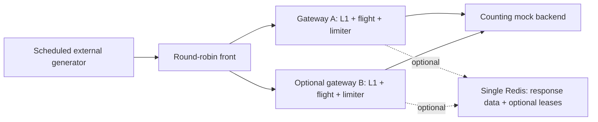

# V2.7 final comparison

V2.7 is complete. The final study includes twelve principal steady trials, twelve
cold bursts, a five-minute soak, fault reproduction, and a source-only rebuild.
All metrics reconciled; nonzero errors and the interrupted startup are retained.

## What was compared



| Mode | Gateways | Local response cache and flights | Redis | Backend permits/queue slots |
|---|---:|---|---|---|
| local-one | 1 | yes | none | 32/32 |
| local-two | 2 | independent | none | 16/16 per node |
| shared | 2 | yes | responses, no leases | 16/16 per node |
| leased | 2 | yes | responses and leases | 16/16 per node |

`shared` means shared response storage without distributed leases; it retains L1.
It is distinct from `-cache-mode shared`, which disables L1. V2.4 already compared
that tier-only path. `local-one` is v1-like behavior in the current implementation,
including current metrics and admission, not the unmodified historical V1 binary.
Historical V1 throughput numbers used a different process/load-generator design
and are not used to calculate a V2 speedup.

Every configuration uses the same front hop and aggregate 32 permits, 32 upstream
queue slots, 64 local flight keys and 1024 waiting cache-miss clients. These are
configured sums of local limits, not a globally strict distributed limit. Each
node keeps its own 1000-entry/16 MiB-body L1; adding a node therefore doubles the
aggregate L1 budget. Redis adds a separate 64 MiB noeviction dataset budget. This
is not an equal-total-memory scaling comparison.

## Method

The principal workload schedules 500 arrivals/sec: 80% hot-key and 20% generated
unique-key requests, a 50ms public mock backend, five-second warmup, and 30-second
measurement. Three trial blocks rotate mode order. Modes within a block share
seed and planned arrivals; sent requests, generator drops and scheduling lag are
reported rather than assumed equal. Generator concurrency/connections are 256;
client deadline is 3s. Gateway deadline is 10s; lease defaults are 3s duration,
2s fill, 4s wait, 25-50ms polling and 250ms safety margin. Redis operations have a
50ms bound. Front timeout is 12s and readiness probe timeout 250ms.

Cold tests instead use 100 barrier-start clients and a 500ms backend delay to
create controlled overlap. The leased mixed soak runs five minutes after warmup.
Every topology starts fresh processes and independent caches. Redis persistence
is disabled. The pinned Redis test build uses libc allocation and -O1; these
numbers are not measurements of a default-optimized production Redis build. Monitoring samples native process CPU/RSS about once per second;
Redis CPU/RSS comes from its own INFO, rather than the Windows WSL launcher.

Successful RPS divides successful requests by measured elapsed time, including
in-flight drain/aggregation. Percentiles describe actual-send and scheduled-start
latency across all sent requests, including unsuccessful responses. Trial p99s
are not pooled into a fictitious aggregate p99. Planned offered rate is a ceiling
on this experiment, not a maximum server-capacity result.

CPU deltas span first-to-last samples inside the measured phase, omitting phase
edges. Maximum sampled RSS is not true peak RSS. Observer operations have cost;
Redis INFO sampling is outside the gateway cache-dependency operation counter.
Windows, WSL2, generator and servers share one host and scheduler. Short trial
ranges do not establish statistical significance or production capacity.

## Results

Three 30-second trials per mode, following a five-second warmup. Values below
are medians of trial measurements, followed by observed trial ranges; percentile
ranges describe trial percentiles rather than pooled samples.

| Mode | Successful RPS | Send p50 ms | Send p95 ms | Send p99 ms | Scheduled p99 ms |
|---|---|---|---|---|---|
| local-one | 499.00 [498.94, 499.18] | 1.11 [1.08, 1.34] | 54.82 [53.52, 56.31] | 83.18 [69.75, 89.27] | 86.57 [71.32, 125.39] |
| local-two | 498.93 [498.68, 499.18] | 1.14 [0.69, 1.17] | 54.25 [52.21, 54.40] | 62.92 [60.48, 71.08] | 64.26 [61.70, 73.50] |
| shared | 499.07 [498.86, 499.16] | 1.10 [1.08, 1.56] | 56.46 [55.35, 58.78] | 76.04 [63.42, 84.39] | 79.02 [64.73, 96.17] |
| leased | 498.98 [498.15, 499.09] | 1.10 [1.10, 1.17] | 60.44 [59.55, 63.11] | 93.79 [71.76, 111.05] | 97.48 [72.76, 120.54] |

At a fixed 500 arrivals/sec, these results do not show a maximum-throughput
scaling improvement. Most backend work comes from unique keys; shared response
storage alone did not reduce completed fills in these overlapping-miss trials.
Leases reduced a few repeated hot-key fills but added coordination operations.
The leased p99 median was higher here; these short shared-host trials do not
isolate one mechanism as the sole cause of tail-latency differences.

| Mode | Backend calls | Dependency operations | L1 request hit ratio | Shared lookup hit ratio | Local followers | Distributed followers |
|---|---|---|---|---|---|---|
| local-one | 2973 [2969, 3034] | 0 [0, 0] | 79.77 [79.35, 79.79]% | - | 62 [61, 64] | 0 [0, 0] |
| local-two | 2976 [2972, 3037] | 0 [0, 0] | 79.78 [79.36, 79.79]% | - | 59 [56, 61] | 0 [0, 0] |
| shared | 2976 [2972, 3037] | 5952 [5944, 6074] | 79.73 [79.33, 79.77]% | 0.00 [0.00, 0.00]% | 63 [62, 64] | 0 [0, 0] |
| leased | 2973 [2968, 3034] | 14882 [14855, 15185] | 79.70 [79.17, 79.71]% | 0.05 [0.05, 0.08]% | 72 [67, 88] | 3 [3, 3] |

Dependency operations count gateway cache-dependency histogram observations,
including GET, acquire, publish and cleanup; they exclude observer INFO commands.
Process-lifetime backend peaks (warmup included) by trial were local-one: [21, 15, 13]; local-two: [13, 22, 16]; shared: [16, 25, 16]; leased: [16, 24, 18].

L1 ratio is hits/(hits+misses), at client-request level. Shared lookup ratio is
hits/(hits+misses) per lookup, including owner rechecks/polls. It is not a fraction
of all client requests. Shared's zero lookup reuse in this workload is itself a
result; V2.4 separately proves completed A-to-B response reuse.

| Mode | Generator drops by trial | Late arrivals by trial | 503s by trial | Dependency errors by trial | Transport errors by trial |
|---|---|---|---|---|---|
| local-one | [0, 0, 0] | [683, 390, 774] | [0, 0, 0] | [0, 0, 0] | [0, 0, 0] |
| local-two | [0, 0, 0] | [229, 432, 533] | [0, 0, 0] | [0, 0, 0] | [0, 0, 0] |
| shared | [0, 0, 1] | [302, 774, 490] | [0, 0, 0] | [0, 0, 0] | [0, 0, 0] |
| leased | [0, 0, 0] | [852, 503, 466] | [0, 0, 1] | [0, 0, 1] | [0, 0, 0] |

Shared trial 3 dropped one planned arrival in the generator; it never reached the
front. Leased trial 3 returned one coordination_error 503, accompanied by one
lease error and no shared-read/write error. This counter pattern places the error
on the acquisition path; its underlying cause was not retained, so a timeout is
not asserted. That flight did not fetch the backend: reduced backend calls must
not all be described as beneficial work suppression. There were no front-level
unavailable responses. All failures and dropped arrivals remain in the accounting.

Three controlled 100-client cold bursts per mode are recorded separately: one
backend fill for local-one, two for local-two, two for shared storage without
leases, and one for leased mode. The 500ms backend creates overlap; this does not
mean every real-world burst always has exactly those counts. All cold clients
succeeded with consistent bodies. Shared storage alone cannot coordinate cold
misses; bounded leases can suppress duplicate fills under the tested assumptions.

The five-minute leased/protection-first mixed soak offered and sent 150,000
requests: **149,997 successes, 3 coordination_error 503s**, zero generator drops
and zero transport errors. Successful throughput was 499.84 RPS;
send p50/p95/p99 were 1.08/59.11/73.63ms,
and scheduled p99 was 75.16ms. There were 3,941 arrivals over
one 2ms scheduling interval late; scheduling-lag p99 was 4.05ms.

The soak made 30,029 backend calls and 150,298 dependency operations;
3 dependency errors were retained. No low-level cause is asserted. The
process-lifetime backend peak, including warmup, was 21 against 32 aggregate
permits. Sampled cache/work bounds held and final work gauges drained.

Gateway-0 RSS medians in the first/last 60 seconds were
18.75/20.44 MiB;
gateway-1 was 18.72/19.65 MiB.
Their maximum sampled RSS values were 21.30 and 20.69 MiB.
Memory was not perfectly flat; one five-minute workload does not prove absence
of a long-term leak. Generator RSS reached 81.54 MiB while retaining
request samples for exact percentiles, separately from gateway memory.


See [per-process CPU/RSS and soak resources](final-resources.md),
[raw trials](../../bench/results/v2/20261103-224701-v27/trials.jsonl),
[summary](../../bench/results/v2/20261103-224701-v27/summary.json),
[manifest](../../bench/results/v2/20261103-224701-v27/manifest.json), and
[machine details](../../bench/results/v2/20261103-224701-v27/hardware.json).


## Failure and survival boundaries

| Event | What survives | What does not / required assumptions |
|---|---|---|
| One gateway dies | healthy peer; fresh Redis data until TTL | dead node L1/flight; in-flight client can fail; orphan lease waits for expiry |
| Owner resumes after expiry | token-checked Redis publication rejects old owner | backend execution may already have duplicated; tokens do not fence backend side effects |
| Redis stops/restarts | fresh per-node L1 | responses/leases in disposable Redis; stale pool connections can fail their first operation |
| Coordination unavailable, protection-first | fresh L1 and local limits | misses return observable 503 |
| Coordination unavailable, available-local | local coalesced fills and local limits | duplicate backend work and divergent L1 snapshots are possible |
| Memory pressure | finite TTL and bounded Redis operations | noeviction produces errors; maxmemory is not a total Redis RSS bound |
| Cache admission is full | L1 hits and existing bounded work | misses can be shed; inbound connections/slow cached consumers are not globally bounded |

These properties depend on one Redis authority, finite TTLs, supported public
responses, and aligned clocks in the same-host experiment. There is no consensus,
Redis failover, renewal, strict distributed backend limiter or exactly-once claim.
The front selects once; it does not retry through an alternate gateway. Standard
HTTP transport reconnection behavior is not an exactly-once guarantee either.

## Reproduce

Prerequisites: Go 1.25+, Python 3 using only its standard library, and pinned Redis
7.4.2. See [the pinned WSL/Linux source build](faults.md#reproduce-the-fault-matrix)
if `bin/redis-build/redis-server` is not available. Windows tests with the race
detector need the documented MSYS2 compiler in PATH. Native Windows plus WSL2 and
Linux /proc resource sampling are supported; macOS sampling is not implemented.

```powershell
python bench/run-v27.py --complete
```

This builds all Go programs, runs the comparison/cold bursts/five-minute soak,
reconciles metrics, runs ordinary/race tests, vet/build, reproduces all ten V2.6
fault cases (more than two required failures), and rebuilds a source-only snapshot
for a four-mode smoke reproduction. Redis is isolated and owned by the harness;
all owned processes are stopped on completion/failure. Expect roughly 12 minutes
of timed workload plus process setup, verification and clean-source checks.

For a short reproduction without a capacity/soak claim:

```powershell
python bench/run-v27.py --quick --complete
```

On Linux add `--redis-server /absolute/path/to/redis-server` as needed. Other flags
include `--seconds`, `--warmup`, `--trials`, `--cold-trials`, `--soak` and `--rate`.
Re-run `python bench/summarize-v27.py <artifact-directory>` to verify raw accounting.
Prior reports/artifacts are preserved; every run writes a new timestamped folder.
An interrupted run can resume with identical settings and matching application/
binary hashes, preserving completed trials and assigning new attempt filenames:

```powershell
python bench/run-v27.py --complete --skip-build --resume bench/results/v2/20261103-224701-v27
```

The recorded study resumed after a transient readiness HTTP parsing error before
shared cold trial 3. The twelve steady and ten completed cold trials were retained;
only the two unfinished cold cases and soak ran afterward. Original failure logs,
the FAILED marker and [resume metadata](../../bench/results/v2/20261103-224701-v27/resume-1.json)
remain. SUCCESS indicates that the resumed workflow's requested checks completed.
Bounded readiness retries and distinct fixture ports were added; application source
and binary hashes were verified unchanged. The exact cause of the invalid echoed
HTTP status line was not established; this was a fixture startup failure, not an
extra workload rejection. The earlier short smoke study is retained separately.


The source-only check copies code, module files and harness sources into an ignored
isolated directory, without prebuilt Go binaries or historical results. It rebuilds
there and runs the four normal modes/cold bursts. Source hashes identify that
snapshot; the normal content-addressed Go compilation cache is allowed. This is
not a claim of a newly committed clean Git revision or an empty toolchain cache.

## Explaining the project

- Built and tested a Go API gateway with bounded caching, local coalescing,
  overload admission, and optional Redis response/lease coordination.
- Demonstrated fewer duplicate backend fills under a controlled cold-key burst;
  verified stale-owner rejection, expiry-based recovery and explicit degraded policies.
- Built separate-process performance/fault experiments with scheduled-latency
  accounting, CPU/RSS attribution, counter reconciliation and a five-minute soak.

Use the measured tables and linked raw artifacts for numerical claims. This is a
tested infrastructure learning project, not production employment, a complete
commercial gateway, a business-domain modeling project, or novel distributed-lock
research. The useful story is which guarantees were added, what each cost, and
which failure assumptions remain.

## Final verification and artifact index

- [Study verification and source/binary checks](../../bench/results/v2/20261103-224701-v27/verification.json).
- [Ordinary tests](../../bench/results/v2/20261103-224701-v27/tests.txt),
  [race tests](../../bench/results/v2/20261103-224701-v27/race.txt),
  [vet](../../bench/results/v2/20261103-224701-v27/vet.txt), and
  [build](../../bench/results/v2/20261103-224701-v27/build.txt) passed. Empty vet/build
  logs mean the commands completed without diagnostics; subprocess status is checked.
  Shutdown coverage includes successful draining and forced cancellation after a
  bounded deadline, not a claim that every client survives a killed process.
- [Final ten fault reproductions](../../bench/results/v2/20261103-230623-v26/summary.json)
  passed. This final reproduction used normal binaries; [V2.6](faults.md) also
  records the race-instrumented fault matrix. Final Go tests ran with the race detector.
- [Clean-source snapshot hashes](../../bench/results/v2/20261103-224701-v27/clean-source.json)
  match the checkout inputs. Its rebuilt [eight-case smoke results](../../bench/results/v2/20261103-224701-v27/clean-source-results/summary.json)
  passed without copying prebuilt Go binaries or historical measurement results.
- [Earlier harness smoke](../../bench/results/v2/20261103-224526-v27/summary.json)
  is a short correctness check, not part of the principal performance ranges.

The resumed study kept all 22 previously completed trials. Its original FAILED
marker describes the startup interruption; SUCCESS marks eventual completion.
[Initial source/binary hashes](../../bench/results/v2/20261103-224701-v27/manifest.json)
and [resumed harness hashes](../../bench/results/v2/20261103-224701-v27/resume-1.json)
identify the unchanged application and the readiness/resume correction separately.
Historical V1 and earlier V2 results remain unchanged.
