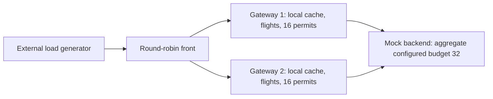

# V2.3 - Independent gateways behind a round-robin front

Implemented and measured 2026-11-03 (America/Chicago). This milestone demonstrates
multiple independent gateways; no shared cache or distributed lease is implemented.



## Behavior and reproduction

```powershell
# Build once and execute all six cases, three trials each.
./bench/run-v23-study.ps1
python bench/summarize-v23.py --index bench/results/v2/<emitted-index>.jsonl --output bench/results/v2/v23-summary.json

# Individual cases:
./bench/run-v23.ps1 -Scenario burst -Gateways 2 -Direct
./bench/run-v23.ps1 -Scenario burst -Gateways 2
./bench/run-v23.ps1 -Scenario failure -Gateways 2
./bench/run-v23.ps1 -Scenario steady -Gateways 1 -Direct
./bench/run-v23.ps1 -Scenario steady -Gateways 1
./bench/run-v23.ps1 -Scenario steady -Gateways 2
```

`cmd/frontproxy` accepts comma-separated `-targets` gateway origins and matching
`-readiness` admin URLs. Defaults are gateways on 8080/8090, readiness on
8081/8091, front data on 8082, and numeric loopback administration on 8083.
Configured targets have fixed unique IDs. The front chooses one healthy target
per incoming request under a short mutex, advances its round-robin cursor, and
forwards through one shared connection pool. It does not retry through another
gateway on failure. Go's standard transport can reconnect to the same selected
target after a stale idle connection; selection is not repeated and this is not
an exactly-once wire-attempt guarantee.

The front's admin `/healthz` means the process is alive; `/readyz` returns 200 if
at least one target is healthy, otherwise 503. `/metrics` exposes per-target
healthy state, probe counts/failures, selections, forwarding errors, and global
incoming/completed/unavailable/aborted/active counts. There are no request URL or
key labels. Probes run every 100 ms with a 100 ms deadline; redirects are not
followed. Only probes update health: a caller cancellation does not declare a
gateway unhealthy. A stale healthy observation can still route a request to a
dead gateway, producing 502/504. No healthy target yields 503. Recovery is observed
by later probes; there is no config reload or sophisticated balancing algorithm.

The harness uses a two-second whole forwarding deadline, ten-second gateway
upstream deadline, and three-second generator deadline. It waits for each gateway
and all configured front targets to become ready before the workload. Each trial
starts fresh backend counters and independent gateway caches. All processes have
captured arguments/PIDs, logs, hashes, and per-process CPU/RSS samples; `finally`
cleanup stops every owned child, including restarted gateways. Port discovery
releases a temporary listener before bind; competing binds fail visibly. Abrupt
termination of the harness host or machine cannot guarantee `finally` execution.

The front preserves HTTP forwarding semantics but deliberately does not add
forwarding-identity headers: extra headers would bypass this project's narrow
public-response cache. Rewrite strips untrusted forwarding headers. This is not
a production client-identity/authentication design. CONNECT/upgrades are excluded.
Connection reuse has a 256-connection per-target ceiling, enough to avoid masking
gateway admission at the study's 256-client generator cap. It is not a global
front admission limit; additional front-side queueing remains possible at higher
concurrency. Admin and health requests are separate from data request counts.

## Controlled cold bursts

For both direct-to-two and front-to-two paths, each of three trials released 100
requests behind a client barrier against an empty cache. The backend's 500 ms
delay kept the controlled requests overlapping:

- 100 successful responses with identical bodies and zero transport errors.
- Exactly 50 requests, one backend fetch, and 49 local followers per gateway.
- Exactly two backend calls overall, and all work gauges drained to zero.

The direct path makes the same observation without relying on front routing.
This establishes one fill per reached gateway under the controlled overlap;
it does not mean every arbitrary workload always causes exactly two calls.
Local caches and flight groups do not coordinate across processes.

## Gateway removal and rejoin

Each of three trials primes both caches, force-stops gateway 1, sends transition
traffic, waits until the front observes it unhealthy, then sends 100 requests to
the survivor. It restarts gateway 1 at the same addresses and waits for both
readiness observations before sending another 100 requests.

| Trial | Transition statuses | Survivor successes | Rejoined successes | Backend calls at end | Stop-to-exclusion observation ms |
|---|---|---|---|---|---|
| 1 | {'200': 100} | 100 | 100 | 3 | 244.4 |
| 2 | {'200': 100} | 100 | 100 | 3 | 199.2 |
| 3 | {'200': 100} | 100 | 100 | 3 | 210.1 |

All observed transition requests succeeded because exclusion occurred before
those requests reached the stopped gateway. This does not establish zero-downtime
failover: the unit test deliberately selects a dead target under stale health,
observes 502, and verifies the other gateway was not contacted as a retry.
Observation times include generator startup, the transition burst, and harness
polling, not only the probe's internal detection latency.

The survivor serves its existing cache. The restarted gateway has fresh counters
and an empty cache: it makes one new fill, bringing backend calls from two to
three. After rejoin, another 100 requests split 50/50. The coordinator segments
snapshots across the restart rather than subtracting reset counters. Each node
retains its configured budget; a surviving 16-permit node does not automatically
inherit the stopped node's 16 permits. This fault test uses a primed hot key,
not an overloaded cold-miss workload during failure.

## Fixed aggregate budget comparison

One gateway has 32 permits and 32 queued slots; two have 16 permits and 16 queued
slots each. The harness fixes these aggregate budgets at 32, rather than silently
doubling backend admission. This is configuration, not a cluster-wide limiter.
The per-instance cache capacity remains unchanged, so total cache capacity grows
with two processes. Unique keys avoid reuse as a confounding benefit here.

Each topology has three six-second scheduled-arrival trials after one-second
warmup: 800 planned arrivals/sec, 50 ms backend delay, fixed seed, at most 256
client operations, and successful full-body RPS including drain. Percentiles are
medians of per-trial percentiles across all sent responses, including errors.
Runs use separate native processes on one Windows host (Core Ultra 7 155H,
roughly 15.5 GiB RAM, Go 1.25.7). Fixed order and host/thermal activity limit causal
interpretation; these short runs are not production capacity estimates.

| Topology | Success RPS median [range] | Client 503 % | p95 ms | p99 ms | Scheduled p99 ms | Generator drops | Front unavailable 503s | Backend peak |
|---|---|---|---|---|---|---|---|---|
| 1 gateway(s), direct | 611.4 [598.2-617.5] | 22.67 | 102.49 | 118.30 | 118.88 | 0 | 0 | 32 |
| 1 gateway(s), front | 600.9 [591.6-604.9] | 23.92 | 111.24 | 155.00 | 155.76 | 0 | 59 | 32 |
| 2 gateway(s), front | 608.9 [555.5-629.4] | 24.11 | 108.30 | 162.12 | 165.21 | 1 | 0 | 32 |

Two gateways did not double successful throughput with the same backend budget.
Backend peaks remained at or below 32; each instance's sampled active work and
queue count stayed within its assigned 32/32 or 16/16 limits. All transport-error
counts were zero. One scheduled arrival was dropped by the two-front generator
and remains in the report; unsent work is not a gateway rejection.

One readiness probe failed in the one-front trial while the gateway process
remained alive, leading to 59 front-level no-healthy-target 503s. Those are
separate from gateway queue-full/wait-timeout errors. The artifacts do not retain
the specific probe error, so its exact cause cannot be established; a short
100 ms deadline and host scheduling are possible contributors. Aggressive probes
trade faster detection for false exclusions. This observation is retained rather
than discarded or called a gateway admission rejection.

Front cost is observed separately below. CPU deltas use periodic samples inside
the measurement phase and omit unsampled edges; RSS values are maximum sampled
RSS, not exact peaks. Gateway RSS sums are sums of each process's sampled maximum,
not a simultaneous aggregate peak. All these processes share one host.

| Topology | Front CPU seconds median (sample window) | Front max sampled RSS MiB | Gateway CPU sum median | Gateway sampled-max RSS sum median MiB |
|---|---|---|---|---|
| 1 gateway(s), direct | n/a | n/a | 2.78 | 28.61 |
| 1 gateway(s), front | 3.02 | 29.05 | 2.94 | 28.78 |
| 2 gateway(s), front | 2.91 | 33.12 | 2.33 | 44.66 |

These observations do not isolate a universal per-request front overhead or prove
that adding processes improves capacity. They expose the extra process cost and
show the request/queue/failure path across the complete topology.

## Diagnostic runs and decisions

The initial front used a 64-connection per-target pool. Under overload that pool
queued requests before the gateway's bounded admission policy could reject them.
The initial one-front set had 1,097 generator drops and about 400 ms median p99.
It remains in `v23-initial-steady.summary.json`. The final front raises the ceiling
to 256, matching the generator cap for one target; two-target actual concurrency
is still bounded by that same generator. The final one-front set had zero drops.
Different run order/host activity and health outcomes prevent treating the timing
difference as a precise general optimization percentage.

A final code review also made readiness probes the only authority for healthy
state, so caller cancellations cannot falsely mark targets down. Cancellation,
controlled failure, and all canonical runs use the final behavior. Earlier smoke
and failure runs remain diagnostics outside the explicit canonical index.

The design intentionally uses fixed round robin, best-effort probes, and no
alternate-target retries. It does not provide cross-instance cache coherence,
automatic permit rebalance, global admission, durable routing state, cloud
failover, or distributed consensus. V2.4 shared caching and V2.5 leases remain
planned; shared storage alone will not promise suppression of overlapping fills.

## Verification and artifacts

- [Canonical six-case index](../../bench/results/v2/v23-study-20261103.jsonl)
- [All 18 canonical trial summaries](../../bench/results/v2/v23-study-20261103.summary.json)
- [Ordinary tests](../../bench/results/v2/v23-tests.txt) and [race tests](../../bench/results/v2/v23-race.txt)

Tests cover direct/front cold bursts with a held backend, exact 50/50 routing,
98 followers and two fills, no-target readiness, dead-target 502 without retry,
probe deadlines, URL validation, and cancellation independent of health. Ordinary
and race tests, vet, build, formatting, and whitespace checks passed. All owned
children were cleaned up after trials. Counter reconciliation covers per-instance
requests/statuses/cache misses/backend calls, front selections/unavailable
responses, drops, histogram totals, restart resets, and drained work gauges.
The original V1 plan and historical V1/V2.0-V2.2 result records were preserved.
