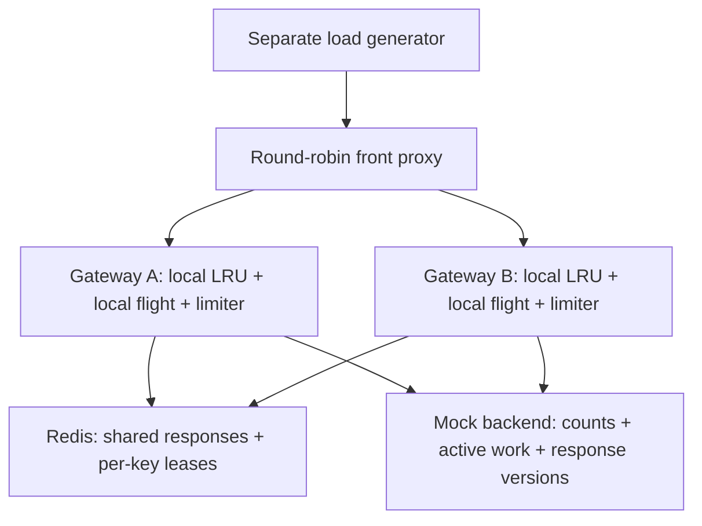

# API Gateway v2 — Multi-instance caching and overload experiments

**Status:** V2.0-V2.3 implemented and verified. V2.4-V2.7 remain planned.
V2.3 evidence: [independent gateways and front routing](docs/v2/multi-instance.md).
V2.2 evidence: [bounded admission study](docs/v2/admission.md).
See [V2 reproduction](docs/v2/README.md), [results](docs/v2/results.md), and
[verification](docs/v2/verification.md).

**Baseline:** v1 local commit `465d9f4`. Keep v1 results as historical evidence. The `v1-baseline` tag points to
`a567362`, which adds documentation above that implementation commit.

**Purpose:** Extend the gateway from one process to multiple instances and study
what changes when cache state, coordination, and failures cross process boundaries.

## 1. Central question

> When multiple gateways receive the same cold-key burst, how can they reduce
> duplicate backend work without hanging clients or depending on perfect coordination?

Supporting questions:

1. Which v1 results persist when the load generator, gateway, and backend run in
   separate processes under a controlled arrival rate?
2. How should admission limits balance successful throughput, latency, and rejection?
3. How do local caches and coalescing behave when requests reach different gateways?
4. What happens when a shared-cache dependency slows down, restarts, or loses a lease owner?

This is a distributed systems learning project, not a claim of production operation,
consensus implementation, exactly-once execution, or novel research.

## 2. Scope

### Required

- Retain the existing public-response eligibility and size limits.
- Use separate load-generator, gateway, and backend processes.
- Compare closed-loop and scheduled-arrival workloads with explicit generator limits.
- Add low-cardinality per-instance metrics and bounded structured request logs.
- Make overload experiments reproducible before introducing shared state.
- Run two gateways behind a simple round-robin front proxy.
- Add an optional shared response cache, using one local Redis instance initially.
- Add a per-key lease as a best-effort cross-instance duplicate-work suppression mechanism.
- Exercise coordination failures and document degraded-mode behavior.
- Preserve a local-only mode that needs no Redis.

### Excluded from required v2

- Kubernetes, cloud deployment, service discovery, and multi-region operation.
- Redis Cluster, Redis failover, Redlock, or a custom consensus protocol.
- Authentication platform, multi-tenant quotas, and broad HTTP-cache compliance.
- Automatic retries of backend requests, automatic lease renewal, and adaptive
  concurrency control. These are possible follow-ups after fixed-policy experiments.
- A globally strict backend concurrency limit: permits remain per gateway.
- Domain-driven business modeling; this remains infrastructure software.

Redis is proposed as a concrete shared-state dependency, not as a guarantee of
distributed mutual exclusion through failures. Use one pinned compatible server
and client version, selected and recorded during implementation.

## 3. Target topology

The front proxy can reuse the existing HTTP proxy approach. It selects a healthy
target once per request; no backend retries or sophisticated balancing algorithm.
Its costs are measured separately, and key correctness tests send directly to
both gateways so a front-proxy bug cannot hide coordination behavior.

## 4. Baseline facts to preserve

- v1 cold bursts: 100 eligible requests made 100 backend calls without coalescing
  and one with local coalescing, across three recorded trials.
- v1 mixed full mode rejected about 10.44% while reducing backend work.
- v1 performance measurements shared one process/runtime and used short intervals.
- v1 ordinary tests and race tests passed after the documented Windows compiler
  PATH adjustment. Keep that working setup available.

These observations motivate experiments; they are not acceptance thresholds for v2.
See [v1 results](docs/results.md) and [verification](docs/verification.md).

## 5. Milestones and acceptance criteria

### V2.0 — Preserve v1 and establish a reproducible process harness

**Work**

- Create a v1 baseline tag and a v2 development branch when implementation begins.
- Add a harness that builds binaries, allocates ports, starts processes, waits for
  readiness, captures logs, and stops every child process on failure or completion.
- Record source commit, commands, CPU/RAM/OS/runtime, workload seed, placement,
  payload size, delays, and all gateway settings with each run.
- Write v2 artifacts under `bench/results/v2/` and reports under `docs/v2/`.
- Reproduce proxy-only and full-mode cases without changing gateway behavior first.

**Acceptance**

- A documented command starts the topology and cleans it up, including on errors.
- Each server and generator is a separate process; CPU/RSS are recorded per process.
- Every trial starts with defined cache/counter state. No existing v1 results are overwritten.
- Build, vet, ordinary tests, and race tests pass before changing behavior.

### V2.1 — Measurement quality and operational visibility

**Work**

- Add counters for incoming/completed requests, status class, cache hit/miss,
  local followers, backend attempts, permit rejections, and dependency errors.
- Add gauges for active backend work, permit waiters, flights, entries, and payload bytes.
- Record histograms for request, upstream, cache-dependency, and permit-wait latency.
- Never use raw URLs, keys, credentials, or request IDs as metric labels.
- Expose metrics on a dedicated loopback admin listener; retain simple liveness
  and document readiness behavior for optional dependencies.
- Add structured logs with instance/request IDs, route class, outcome, and timing.
  Do not log authorization, cookies, bodies, or unbounded query values.
- Add scheduled-arrival mode with a fixed seed, bounded generator concurrency,
  connection limits, request deadlines, and a separate count of generator drops.
- Measure scheduled-start-to-completion latency as well as actual-send-to-completion
  latency. Count scheduling lag and missed arrivals; never silently skip them.

**Acceptance**

- Metric deltas reconcile with a deterministic workload and backend counters.
- Generator overload is distinguishable from gateway rejection and transport failure.
- Warmup is excluded; profile runs are separate; all errors remain in reports.
- Collect at least three 30s trials after a 5s warmup for principal steady cases.
  Add a 5-minute representative soak and inspect resource growth.

### V2.2 — Admission control and overload study

**Work**

- Add a separate bound on the number of requests waiting for an upstream permit.
  Full queue and expired wait both shed load with a documented 503 reason.
- Sweep concurrency limits (for example 8/16/32/64), queue capacities, and wait budgets.
- Use healthy, slowed, and recovering backends; vary offered arrival rates.
- Measure success/error rates, p95/p99, backend active work, and waiter memory.
- Select a default from evidence, keeping the original policy as a comparison mode.

**Acceptance**

- Active backend work and queued permit waiters stay within their configured limits.
- Cancellation removes queued waiters and releases resources.
- Cache hits avoid the saturated upstream queue.
- Reports include rejection rate and recovery behavior, not just completed RPS.
- State explicitly that per-key followers and inbound connections need separate
  admission policies; a bounded permit queue alone is not a total-memory bound.

### V2.3 — Demonstrate multiple independent gateways

**Work**

- Start two gateways with unique instance IDs and independent local caches/flight groups.
- Add the round-robin front proxy and per-instance readiness observations.
- Send a cold same-key burst to both instances directly and through the front proxy.
- Compare one gateway with two at the same total offered load and aggregate permit budget.

**Acceptance**

- Both instances receive the controlled burst. Local coalescing suppresses work
  within each instance, but does not coordinate across instances.
- Under controlled overlap, demonstrate one fill per reached gateway (two fills
  for two gateways), rather than assuming all production workloads have exactly two.
- Stopping one instance yields a bounded, observable failure/recovery outcome.
- Scaling from one to two instances does not silently double the experiment's
  intended backend budget: compare 1×32 permits against 2×16, for example.

### V2.4 — Shared cache, without distributed leases first

**Work**

- Introduce a small shared-cache interface only when adding the real adapter.
- Implement bounded reads/writes and connection-pool/operation deadlines.
- Define a versioned serialization format for safe headers, body, and freshness metadata.
- Use a stable, versioned key namespace including upstream identity and the same
  representation inputs as v1. Hashing keys does not make cached payloads private.
- Use Redis remaining TTL to bound local admission; subtract elapsed lookup time
  and cap local lifetime. Reads and promotion must never restart the original TTL.
- Treat corrupt, oversized, unsupported-schema, and expired values as misses.
- Configure Redis total memory and a documented data-key eviction policy. Preserve
  the per-entry bound; include encoded headers/metadata in shared-value size limits.
- Compare local-only, shared-only, and local-plus-shared cache paths.

**Acceptance**

- A completed fill through A can satisfy B without another backend fetch.
- Authorization/cookie/variant-sensitive requests never enter either cache.
- Repeated local promotion does not extend shared freshness indefinitely.
- Concurrent cold misses can still duplicate work; shared storage alone does not
  claim to prevent a cross-instance stampede.
- Cache-operation errors are distinguished from genuine misses.

### V2.5 — Cross-instance coalescing with bounded leases

**Work**

- Keep local coalescing so one local leader per key contacts Redis.
- After a shared miss, attempt an atomic lease acquisition with a unique token
  and finite expiration. Recheck shared data after becoming owner.
- Only the owner starts the speculative backend fill. Its deadline is shorter
  than the lease duration, leaving explicit time for publication/cleanup.
- Nonowners recheck shared data using bounded, jittered polling and cancellation.
  No Pub/Sub dependency is required for the first version.
- Atomically verify current ownership before publishing a shared result. Verify
  ownership before deleting the lease too; a stale owner cannot delete a new lease.
- If ownership is lost, discard shared publication and do not warm L1 from that
  rejected result. The original caller may still receive its own valid response
  under a clearly documented policy.
- Use the v1 individual streaming fallback for unshareable responses. Such
  responses do not become distributed shared results.

**Acceptance**

- With healthy Redis, valid leases, and an overlapping eligible same-key burst
  across two instances, demonstrate one backend fill and successful waiters.
- Leader death before publication causes bounded lease expiry and eventual progress.
- A paused old owner cannot publish over a newer owner's result or delete its lease.
- Test lease acquisition/publication/release atomicity against real Redis, not only a fake.
- Canceling one waiter does not cancel another instance's healthy work.
- Expired leases can permit duplicate backend execution: do not claim exactly-once
  work or strict global mutual exclusion during pauses, partitions, or Redis restart.

### V2.6 — Fault injection and degraded modes

**Work**

- Test Redis unavailable, slow, restarted, memory-pressured, and returning corrupt data.
- Test a gateway killed while holding a lease, a delayed stale leader, backend
  timeout, and an instance restarting with empty local state.
- Choose explicit dependency-degradation policies:
  - **Available-local mode:** fresh L1 hits remain available; shared-cache failures
    fall back to local coalescing and the local limiter after bounded dependency wait.
  - **Protection-first mode:** fresh L1 hits remain available; coordination-dependent
    misses fail with 503 when Redis is unavailable or coordination wait expires.
- Make failure reasons and fallback activation visible in counters and logs.
- Bound shared-flight waiters/admission separately if tests show they can accumulate;
  enforce a configured cap before describing that resource as bounded.

**Acceptance**

- No indefinite waits; no leaked leases that outlive expiration; no lost local permits.
- Failure/recovery tests pass with race instrumentation where applicable.
- The report explains the availability/backend-protection tradeoff of each mode.
- In available-local mode, document that two local limiters can admit their summed
  capacity and that coordination loss can increase duplicate work.

### V2.7 — Final comparison and explanation

**Work**

- Publish topology diagrams, tested failure assumptions, configuration, and one-command reproduction.
- Compare v1-like local mode, two independent gateways, shared cache only, and
  shared cache plus leases under identical offered workloads.
- Report successful RPS, scheduling/generator drops, latency distributions, error
  reasons, backend calls/active work, per-process CPU/RSS, dependency operations,
  cache hit ratios by tier, and local/distributed follower counts.
- Report trial ranges and unsuccessful experiments; distinguish tests from benchmarks.
- Complete the soak, shutdown, ordinary/race tests, and clean-source reproduction.

**Acceptance**

- Another developer can reproduce the normal and at least two failure scenarios.
- Explain which properties survive process failure and which depend on the single Redis instance.
- Resume claims reference measured experiments and describe this as a tested project,
  not production employment experience or an exactly-once distributed platform.

## 6. Lease and cache correctness boundaries

The proposed lease design uses one Redis authority. Its protection is useful for
duplicate-work suppression under stated assumptions. A lease is not a permanent
lock: a delayed process can resume after expiry while another owner is working.

Ownership checking and shared-result publication must form one atomic Redis
operation. Checking a token and later writing independently leaves a race.
Ownership-checked release is necessary too. Redis restart, key eviction, or
failover can invalidate assumptions and increase duplicate backend execution.
Using expiring keys is not evidence of global exactly-once behavior.

Use a controlled backend response version in tests to prove that delayed old
results do not overwrite newer shared data. Define what happens to an old
owner's local response and cache separately from shared publication.

The initial design does not support Redis Cluster, so cross-slot scripting is
outside scope. Protect coordination keys from ordinary cache eviction where
practical; if they can be evicted, treat lease loss as expected and test it.

## 7. Experiment matrix

| Scenario | Comparison / assertion |
|---|---|
| Warm one-key traffic | L1 versus shared-cache round-trip cost |
| Cold same-key burst | One instance; two independent instances; shared cache; leases |
| TTL-expiry burst | Duplicate-work reduction without renewed freshness |
| Mostly unique keys | Coordination overhead with little reuse |
| Increasing offered load | Success, queueing, rejection, and generator saturation |
| Slow/recovering backend | Concurrency/queue limits and recovery without retry storms |
| Redis outage/latency | Available-local versus protection-first behavior |
| Owner crash/pause | Expiry recovery and stale-publication rejection |
| One gateway removed | Load redistribution and aggregate backend pressure |
| Five-minute soak | Resource trends and bounded cleanup |

Do not assume the shared-cache/lease mode is fastest. Extra network calls and
coordination may hurt low-reuse workloads. Favor correctness and explicit failure
behavior over making every graph improve.

## 8. Implementation order and effort

Suggested work blocks, not delivery commitments:

| Block | Milestones | Approximate focused effort |
|---|---|---|
| Better evidence | V2.0–V2.1 | 10–18 hours |
| Overload and multiple processes | V2.2–V2.3 | 10–18 hours |
| Shared data and coordination | V2.4–V2.5 | 16–28 hours |
| Failure experiments and write-up | V2.6–V2.7 | 10–18 hours |

Total: roughly 46–82 hours, highly dependent on experience and fault-test tooling.
Stop after each milestone to review evidence before accepting more infrastructure.
Do not start by adding Redis: first preserve and measure the existing behavior.

## 9. Reading before the relevant milestone

- Existing [system design reading guide](system_design_reading_guide.md): request
  ownership, freshness, queueing, and cancellation.
- Before V2.1: scheduled arrivals, coordinated omission, latency histograms, and
  measurement boundaries. Read the chosen generator's official documentation.
- Before V2.4: serialization boundaries, remaining TTL, cache-aside operation,
  connection pooling, and cache outage policy.
- Before V2.5: leases, expiry, ownership tokens, stale owners, and atomic conditional
  writes. Consult the [Redis lock documentation](https://redis.io/docs/latest/develop/clients/patterns/distributed-locks/)
  for ownership/expiration constraints and the
  [Redis transaction documentation](https://redis.io/docs/latest/develop/using-commands/transactions/)
  for atomicity primitives. This plan intentionally does not adopt Redlock.

## 10. First implementation session

1. Tag the verified v1 baseline and create a v2 branch.
2. Implement only the separate-process harness and cleanup/readiness behavior.
3. Reproduce one proxy-only and one full-mode workload with unchanged gateway logic.
4. Write the environment/commands and inspect measurement differences from v1.
5. Continue to metrics and scheduled arrivals only after that baseline is repeatable.

**First deliverable:** a trustworthy multi-process experiment, before any shared-cache feature.
